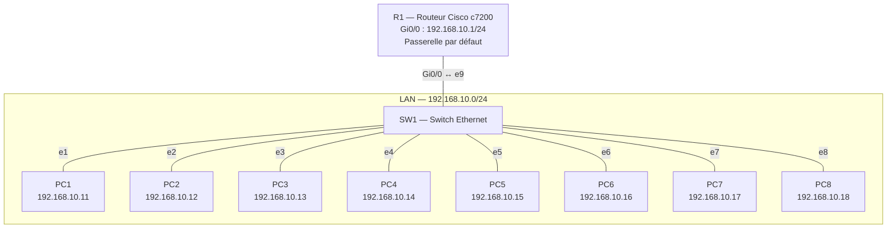

# Projet 1 — Câblage et adressage IP d'un petit bureau

**Cours :** Networking Essentials — Infrastructure informatique et réseau d'une petite entreprise
**Classe :** E1A — Geneva Institute of Technology
**Auteure :** [Rrudhani Deaa]
**Date :** octobre 2026

## Sommaire

[TOC]

---

## 1. Contexte

Un bureau de **8 postes** doit être câblé et configuré en **adressage IP statique**, sur un même sous-réseau. Le réseau a été réalisé et testé dans le simulateur **GNS3**.

## 2. Objectifs

- Concevoir un plan d'adressage IP cohérent.
- Câbler et connecter le switch, le routeur et les postes.
- Configurer une adresse IP statique sur chaque équipement.
- Vérifier la connectivité de bout en bout (ping entre tous les postes).
- Documenter le schéma réseau.

---

## 3. Matériel utilisé

| Équipement | Dans GNS3 | Équivalent réel | Rôle |
| --- | --- | --- | --- |
| R1 | Routeur Cisco c7200 | Routeur d'entreprise | Passerelle par défaut du bureau |
| SW1 | Ethernet switch (switch intégré de GNS3) | Switch 16 ou 24 ports | Relie tous les équipements du bureau |
| PC1 à PC8 | VPCS (Virtual PC Simulator) | Postes de travail | Postes des employés |
| Câbles | Liens Ethernet GNS3 | Câbles RJ45 droits, catégorie 6, norme T568B | Relient chaque équipement au switch |

> **Pourquoi des câbles droits :** on relie des équipements de types différents (PC ↔ switch, routeur ↔ switch). Les câbles croisés servaient autrefois à relier deux équipements du même type (PC ↔ PC, switch ↔ switch).

---

## 4. Type de réseau

Le réseau du bureau est un **LAN** (Local Area Network, réseau local) : tous les équipements sont dans le même bâtiment et dans le même sous-réseau **192.168.10.0/24**.

| Élément | Fait partie du LAN ? |
| --- | --- |
| PC1 à PC8 |  Oui |
| SW1 | Oui, il relie tous les équipements |
| R1 |  Seulement par son interface **Gi0/0** (192.168.10.1), branchée au switch |
| WAN (lien vers Internet) | Non configuré dans ce projet |

R1 joue le rôle de **passerelle par défaut** : c'est par lui que passerait le trafic vers un autre réseau ou vers Internet. Une autre interface de R1 pourrait plus tard être reliée à la box du fournisseur d'accès (côté WAN).

---

## 5. Plan d'adressage IP

### 5.1 Informations sur le réseau

| Élément | Valeur |
| --- | --- |
| Adresse du réseau | 192.168.10.0 |
| Masque | 255.255.255.0 (/24) |
| Première adresse utilisable | 192.168.10.1 |
| Dernière adresse utilisable | 192.168.10.254 |
| Adresse de diffusion (broadcast) | 192.168.10.255 |
| Nombre d'adresses utilisables | 254 |
| Passerelle par défaut | 192.168.10.1 (R1) |

**Pourquoi ce choix :**
- **192.168.10.0** est une adresse **privée** (plage 192.168.0.0/16), réservée aux réseaux internes.
- Un masque **/24** donne 254 adresses : largement assez pour 8 postes, avec de la place pour une imprimante, un serveur ou de nouveaux postes.
- La passerelle a l'adresse **.1**, par convention : elle est facile à retenir.

### 5.2 Répartition des adresses

| Plage | Utilisation |
| --- | --- |
| 192.168.10.1 | Passerelle (R1) |
| 192.168.10.2 à .10 | Réservées aux équipements réseau (switch administrable, point d'accès Wi-Fi…) |
| 192.168.10.11 à .18 | Postes PC1 à PC8 |
| 192.168.10.19 à .254 | Libres (imprimante, serveur, futurs postes) |

### 5.3 Tableau d'adressage

| Équipement | Interface | Adresse IP | Masque | Passerelle | Port SW1 |
| --- | --- | --- | --- | --- | --- |
| R1 | Gi0/0 | 192.168.10.1 | 255.255.255.0 | — | e9 |
| PC1 | e0 | 192.168.10.11 | 255.255.255.0 | 192.168.10.1 | e1 |
| PC2 | e0 | 192.168.10.12 | 255.255.255.0 | 192.168.10.1 | e2 |
| PC3 | e0 | 192.168.10.13 | 255.255.255.0 | 192.168.10.1 | e3 |
| PC4 | e0 | 192.168.10.14 | 255.255.255.0 | 192.168.10.1 | e4 |
| PC5 | e0 | 192.168.10.15 | 255.255.255.0 | 192.168.10.1 | e5 |
| PC6 | e0 | 192.168.10.16 | 255.255.255.0 | 192.168.10.1 | e6 |
| PC7 | e0 | 192.168.10.17 | 255.255.255.0 | 192.168.10.1 | e7 |
| PC8 | e0 | 192.168.10.18 | 255.255.255.0 | 192.168.10.1 | e8 |

---

## 6. Schéma réseau

### 6.1 Topologie annotée dans GNS3

La topologie est en **étoile** : chaque équipement est relié directement au switch SW1.


### 6.2 Schéma simplifié



---

## 7. Câblage

### 7.1 Création de la topologie dans GNS3

1. **File → New blank project** → nom du projet : `NE-P1-Bureau`.
2. Ajout des équipements : 1 routeur **c7200** (R1), 1 **Ethernet switch** (SW1), 8 **VPCS** (PC1 à PC8).
3. Câblage avec l'outil **Add a link** (icône de câble), selon le tableau ci-dessous.
4. Démarrage de tous les équipements (bouton ▶ vert).

>  Il faut bien choisir **Ethernet switch** et pas *ATM switch* ou *Frame Relay switch*, qui sont des technologies d'opérateurs incompatibles avec des PC en Ethernet.

### 7.2 Configuration du switch SW1

Le switch intégré de GNS3 ne se configure pas en ligne de commande, mais par l'interface graphique. Par défaut, il n'a que **8 ports** (0 à 7), alors qu'il en faut **9** (8 PC + 1 routeur). Des ports ont donc été ajoutés :

1. Clic droit sur **SW1** → **Configure**.
2. Pour chaque port à ajouter : **Port** = numéro, **VLAN** = `1`, **Type** = `access` → bouton **Add**.
3. **Apply** → **OK**.

| Paramètre | Signification |
| --- | --- |
| VLAN 1 | VLAN par défaut : tous les ports sont dans le même réseau local |
| Type `access` | Le port appartient à un seul VLAN, c'est le type utilisé pour brancher un poste ou un routeur |


### 7.3 Tableau de câblage

| Port SW1 | Équipement | Interface | Type de câble |
| --- | --- | --- | --- |
| e1 | PC1 | e0 | Droit |
| e2 | PC2 | e0 | Droit |
| e3 | PC3 | e0 | Droit |
| e4 | PC4 | e0 | Droit |
| e5 | PC5 | e0 | Droit |
| e6 | PC6 | e0 | Droit |
| e7 | PC7 | e0 | Droit |
| e8 | PC8 | e0 | Droit |
| e9 | R1 | Gi0/0 | Droit |

---

## 8. Configuration des équipements

### 8.1 R1 — Routeur

Double-clic sur R1 pour ouvrir sa console.

```bash
enable
configure terminal
hostname R1
interface GigabitEthernet0/0
 description LAN Bureau - vers SW1
 ip address 192.168.10.1 255.255.255.0
 no shutdown
 exit
end
write memory
```

| Commande | À quoi elle sert |
| --- | --- |
| `enable` | Passe du mode utilisateur (`R1>`) au mode privilégié (`R1#`), qui donne accès à toutes les commandes |
| `configure terminal` | Entre en mode de configuration globale (`R1(config)#`) |
| `hostname R1` | Donne le nom **R1** au routeur |
| `interface GigabitEthernet0/0` | Sélectionne l'interface reliée au switch, pour la configurer |
| `description LAN Bureau - vers SW1` | Ajoute une description : indique à quoi sert l'interface (utile pour la maintenance) |
| `ip address 192.168.10.1 255.255.255.0` | Attribue l'adresse IP de la passerelle et son masque |
| `no shutdown` | Active l'interface : sur un routeur Cisco, les interfaces sont éteintes par défaut |
| `exit` | Sort de la configuration de l'interface |
| `end` | Quitte le mode configuration et revient au mode privilégié |
| `write memory` | Sauvegarde la configuration, pour qu'elle soit conservée après un redémarrage |

**Vérification :**

```bash
show ip interface brief
```

Cette commande affiche un résumé de toutes les interfaces du routeur.

| Colonne | Signification | Résultat pour Gi0/0 |
| --- | --- | --- |
| IP-Address | Adresse IP de l'interface | 192.168.10.1 |
| Method | Comment l'adresse a été configurée | `manual` (configurée à la main) |
| Status | État physique (couche 1) : câble branché et interface activée | `up` |
| Protocol | État logique (couche 2) : l'interface communique | `up` |

Les autres interfaces sont en `administratively down` : elles ne sont pas utilisées, donc laissées éteintes. C'est aussi une bonne pratique de sécurité.


### 8.2 Postes PC1 à PC8 (VPCS)

Chaque PC est configuré avec les mêmes 3 commandes, seule l'adresse IP change. Double-clic sur le PC pour ouvrir sa console.

| Commande | À quoi elle sert |
| --- | --- |
| `ip 192.168.10.X/24 192.168.10.1` | Attribue en une seule fois l'**adresse IP**, le **masque** (/24 = 255.255.255.0) et la **passerelle** (192.168.10.1). VPCS vérifie aussi qu'aucun autre équipement n'utilise déjà cette adresse (« Checking for duplicate address ») |
| `save` | Sauvegarde la configuration du PC (fichier `startup.vpc`), pour qu'elle soit conservée si le projet est redémarré |
| `show ip` | Affiche la configuration IP du PC pour vérifier |

| Champ de `show ip` | Signification |
| --- | --- |
| NAME | Nom du PC |
| IP/MASK | Adresse IP et masque |
| GATEWAY | Passerelle par défaut |
| MAC | Adresse physique (MAC) de la carte réseau du PC |

> Après la commande `ip`, VPCS affiche « PC1 : 192.168.10.X… » sur tous les PC : ce n'est pas une erreur, c'est la numérotation interne de VPCS. La commande `show ip` confirme le vrai nom du PC.

#### PC1

```bash
ip 192.168.10.11/24 192.168.10.1
save
show ip
```

Résultat : 192.168.10.11/24, passerelle 192.168.10.1, MAC `00:50:79:66:68:00`.


#### PC2

```bash
ip 192.168.10.12/24 192.168.10.1
save
show ip
```

Résultat : 192.168.10.12/24, passerelle 192.168.10.1, MAC `00:50:79:66:68:01`.


`

#### PC3

```bash
ip 192.168.10.13/24 192.168.10.1
save
show ip
```

Résultat : 192.168.10.13/24, passerelle 192.168.10.1, MAC `00:50:79:66:68:02`.


#### PC4

```bash
ip 192.168.10.14/24 192.168.10.1
save
show ip
```

Résultat : 192.168.10.14/24, passerelle 192.168.10.1, MAC `00:50:79:66:68:03`.


#### PC5

```bash
ip 192.168.10.15/24 192.168.10.1
save
show ip
```

Résultat : 192.168.10.15/24, passerelle 192.168.10.1, MAC `00:50:79:66:68:04`.


#### PC6

```bash
ip 192.168.10.16/24 192.168.10.1
save
show ip
```

Résultat : 192.168.10.16/24, passerelle 192.168.10.1, MAC `00:50:79:66:68:05`.


#### PC7

```bash
ip 192.168.10.17/24 192.168.10.1
save
show ip
```

Résultat : 192.168.10.17/24, passerelle 192.168.10.1, MAC `00:50:79:66:68:06`.


#### PC8

```bash
ip 192.168.10.18/24 192.168.10.1
save
show ip
```

Résultat : 192.168.10.18/24, passerelle 192.168.10.1, MAC `00:50:79:66:68:07`.


---

## 9. Tests de connectivité

La commande **ping** envoie un message (« Echo Request », protocole ICMP) à une adresse IP, et attend une réponse (« Echo Reply »). Si la réponse arrive, les deux équipements peuvent communiquer.

### 9.1 Depuis R1

```bash
ping 192.168.10.11
ping 192.168.10.12
ping 192.168.10.13
ping 192.168.10.14
ping 192.168.10.15
ping 192.168.10.16
ping 192.168.10.17
ping 192.168.10.18
```

| Élément du résultat | Signification |
| --- | --- |
| `Sending 5, 100-byte ICMP Echos` | R1 envoie 5 paquets de 100 octets |
| `!` | Un paquet a reçu une réponse |
| `.` | Un paquet n'a pas reçu de réponse dans le délai (2 secondes) |
| `Success rate is 80 percent (4/5)` | 4 réponses sur 5 envoyées |
| `round-trip min/avg/max` | Temps aller-retour minimum, moyen et maximum en millisecondes |

**Résultat :** `.!!!!` (80 %) vers les 8 PC. Le premier paquet est perdu car R1 ne connaît pas encore l'adresse MAC du PC : il envoie d'abord une **requête ARP** pour la trouver, et le premier ping expire pendant ce temps. Les 4 suivants passent. C'est un comportement normal : en relançant le même ping, le résultat est `!!!!!` (100 %).


**Vérification de la table ARP :**

```bash
show arp
```

Cette commande affiche la **table ARP** du routeur : la correspondance entre chaque adresse IP et l'adresse MAC de l'équipement, apprise lors des communications.

| Colonne | Signification |
| --- | --- |
| Address | Adresse IP de l'équipement |
| Age (min) | Depuis combien de minutes l'entrée a été apprise (`-` = adresse du routeur lui-même) |
| Hardware Addr | Adresse MAC correspondante |
| Interface | Interface par laquelle l'équipement est joignable |

**Résultat :** les **8 PC** apparaissent avec leur adresse MAC (`0050.7966.6800` à `0050.7966.6807`), toutes sur Gi0/0. Ce sont exactement les adresses MAC affichées par `show ip` sur chaque PC : R1 a bien communiqué avec chaque poste.


### 9.2 Depuis chaque PC

Chaque PC a pingué tous les autres postes.

| Élément du résultat (VPCS) | Signification |
| --- | --- |
| `84 bytes from 192.168.10.X` | Une réponse de 84 octets est arrivée de l'adresse pinguée |
| `icmp_seq=1` | Numéro du paquet |
| `ttl=64` | Durée de vie du paquet : 64 = aucun routeur traversé (même réseau) |
| `time=0.6 ms` | Temps aller-retour |

> L'option `-c 2` (utilisée sur certains pings) envoie 2 paquets au lieu de 5.

#### PC1

```bash
ping 192.168.10.1 -c 2
ping 192.168.10.12 -c 2
ping 192.168.10.13 -c 2
ping 192.168.10.14 -c 2
ping 192.168.10.15 -c 2
ping 192.168.10.16 -c 2
ping 192.168.10.17 -c 2
ping 192.168.10.18 -c 2
```


#### PC2

```bash
ping 192.168.10.11 -c 2
ping 192.168.10.13 -c 2
ping 192.168.10.14 -c 2
ping 192.168.10.15 -c 2
ping 192.168.10.16 -c 2
ping 192.168.10.17 -c 2
ping 192.168.10.18 -c 2
```


#### PC3

```bash
ping 192.168.10.11 -c 2
ping 192.168.10.12
ping 192.168.10.14
ping 192.168.10.15
ping 192.168.10.16
ping 192.168.10.17
ping 192.168.10.18
```


#### PC4

```bash
ping 192.168.10.11
ping 192.168.10.12
ping 192.168.10.13
ping 192.168.10.15
ping 192.168.10.16
ping 192.168.10.17
ping 192.168.10.18
```


#### PC5

```bash
ping 192.168.10.11
ping 192.168.10.12
ping 192.168.10.13
ping 192.168.10.14
ping 192.168.10.16
ping 192.168.10.17
ping 192.168.10.18
```


#### PC6

```bash
ping 192.168.10.11
ping 192.168.10.12
ping 192.168.10.13
ping 192.168.10.14
ping 192.168.10.15
ping 192.168.10.17
ping 192.168.10.18
```


#### PC7

```bash
ping 192.168.10.11
ping 192.168.10.12
ping 192.168.10.13
ping 192.168.10.14
ping 192.168.10.15
ping 192.168.10.16
ping 192.168.10.18
```


#### PC8

```bash
ping 192.168.10.11
ping 192.168.10.12
ping 192.168.10.13
ping 192.168.10.14
ping 192.168.10.15
ping 192.168.10.16
ping 192.168.10.17
```


### 9.3 Matrice de connectivité

✅ = ping réussi

| Depuis ↓ / Vers → | R1 | PC1 | PC2 | PC3 | PC4 | PC5 | PC6 | PC7 | PC8 |
| --- | --- | --- | --- | --- | --- | --- | --- | --- | --- |
| **R1** | — | ✅ | ✅ | ✅ | ✅ | ✅ | ✅ | ✅ | ✅ |
| **PC1** | ✅ | — | ✅ | ✅ | ✅ | ✅ | ✅ | ✅ | ✅ |
| **PC2** | ✅ | ✅ | — | ✅ | ✅ | ✅ | ✅ | ✅ | ✅ |
| **PC3** | ✅ | ✅ | ✅ | — | ✅ | ✅ | ✅ | ✅ | ✅ |
| **PC4** | ✅ | ✅ | ✅ | ✅ | — | ✅ | ✅ | ✅ | ✅ |
| **PC5** | ✅ | ✅ | ✅ | ✅ | ✅ | — | ✅ | ✅ | ✅ |
| **PC6** | ✅ | ✅ | ✅ | ✅ | ✅ | ✅ | — | ✅ | ✅ |
| **PC7** | ✅ | ✅ | ✅ | ✅ | ✅ | ✅ | ✅ | — | ✅ |
| **PC8** | ✅ | ✅ | ✅ | ✅ | ✅ | ✅ | ✅ | ✅ | — |

> Les pings des PC vers R1 sont validés par les pings de R1 vers chaque PC (un ping qui réussit prouve la communication dans les deux sens).

**Conclusion :** tous les équipements communiquent entre eux. La **connectivité est totale** sur le LAN 192.168.10.0/24.

---

## 10. Difficultés rencontrées

| Problème | Cause | Solution |
| --- | --- | --- |
| Hésitation sur le type de switch dans GNS3 | Plusieurs « switches » proposés (ATM, Frame Relay, Ethernet) | Utilisation de l'**Ethernet switch**, le seul adapté à un réseau Ethernet |
| Les ports ajoutés au switch n'étaient pas enregistrés | Il faut cliquer sur **Add** pour chaque port avant **Apply** / **OK** | Ajout des ports un par un avec **Add** |
| `show arp` sur R1 n'affichait que le routeur | La table ARP se vide au redémarrage du projet et ne se remplit que lors des communications | Pings vers les 8 PC, puis `show arp` |
| Premier ping à 80 % (`.!!!!`) | Le premier paquet est perdu pendant la requête ARP | Comportement normal, aucun correctif nécessaire |

---

## 11. Liste des captures

| N° | Fichier | Contenu |
| --- | --- | --- |
| 01 | `01_topologie_annotee.png` | Topologie GNS3 annotée |
| 02 | `02_config_sw1.png` | Ports du switch SW1 |
| 03 | `03_r1_show_ip_int_brief.png` | Interfaces de R1 |
| 04 | `04_pc1_config.png` | Configuration IP de PC1 |
| 05 | `05_pc2_config.png` | Configuration IP de PC2 |
| 06 | `06_pc3_config.png` | Configuration IP de PC3 |
| 07 | `07_pc4_config.png` | Configuration IP de PC4 |
| 08 | `08_pc5_config.png` | Configuration IP de PC5 |
| 09 | `09_pc6_config.png` | Configuration IP de PC6 |
| 10 | `10_pc7_config.png` | Configuration IP de PC7 |
| 11 | `11_pc8_config.png` | Configuration IP de PC8 |
| 12 | `12_r1_pings.png` | Pings de R1 vers les 8 PC |
| 13 | `13_r1_show_arp.png` | Table ARP de R1 |
| 14 | `14_pc1_pings.png` | Pings depuis PC1 |
| 15 | `15_pc2_pings.png` | Pings depuis PC2 |
| 16 | `16_pc3_pings.png` | Pings depuis PC3 |
| 17 | `17_pc4_pings.png` | Pings depuis PC4 |
| 18 | `18_pc5_pings.png` | Pings depuis PC5 |
| 19 | `19_pc6_pings.png` | Pings depuis PC6 |
| 20 | `20_pc7_pings.png` | Pings depuis PC7 |
| 21 | `21_pc8_pings.png` | Pings depuis PC8 |