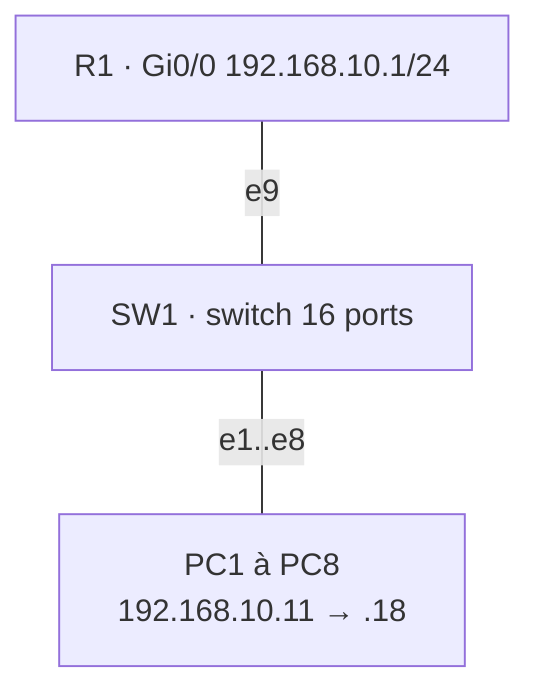

# 01 — Réseau d'un bureau de 8 postes

## Objectif
Câbler et adresser le réseau local d'un petit bureau : 8 postes, un switch et un routeur passerelle, puis valider la connectivité.

## Topologie

## Plan d'adressage

| Équipement | Interface / port | Adresse |
|---|---|---|
| R1 | Gi0/0 → SW1 e9 | 192.168.10.1/24 |
| PC1 … PC8 | e0 → SW1 e1 … e8 | 192.168.10.11 … .18 /24, passerelle .1 |

## Étapes
1. Ajout de SW1 (switch GNS3 étendu à 16 ports), de R1 et de 8 VPCS.
2. Configuration de l'interface LAN de R1 avec description.
3. Adressage statique des postes (`ip 192.168.10.1x 192.168.10.1 24`).
4. Tests : ping entre tous les postes et vers la passerelle, `show arp` sur R1 pour vérifier la résolution des adresses MAC.

## Compétences
Adressage IPv4 et masque /24 · rôle de la passerelle · fonctionnement d'un switch · table ARP

Configurations : [`configs/`](configs/)
