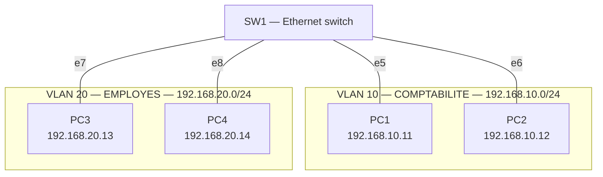

# Projet 2 — Segmentation en VLAN d'un réseau d'entreprise

**Cours :** Networking Essentials — Infrastructure informatique et réseau d'une petite entreprise
**Classe :** E1A — Geneva Institute of Technology
**Auteure :** [ton nom]
**Date :** octobre 2026

## Sommaire

- [1. Contexte](#1-contexte)
- [2. Objectifs](#2-objectifs)
- [3. Principe des VLAN](#3-principe-des-vlan)
  - [3.1 Qu'est-ce qu'un VLAN ?](#31-quest-ce-quun-vlan-)
  - [3.2 Comment ça marche ?](#32-comment-ça-marche-)
  - [3.3 Pourquoi utiliser des VLAN ?](#33-pourquoi-utiliser-des-vlan-)
- [4. Environnement de travail](#4-environnement-de-travail)
- [5. Plan des VLAN et adressage](#5-plan-des-vlan-et-adressage)
  - [5.1 Les VLAN](#51-les-vlan)
  - [5.2 Plan d'adressage](#52-plan-dadressage)
- [6. Schéma réseau](#6-schéma-réseau)
  - [6.1 Topologie annotée dans GNS3](#61-topologie-annotée-dans-gns3)
  - [6.2 Schéma simplifié](#62-schéma-simplifié)
- [7. Configuration du switch SW1](#7-configuration-du-switch-sw1)
  - [7.1 Création du projet](#71-création-du-projet)
  - [7.2 Attribution des ports aux VLAN](#72-attribution-des-ports-aux-vlan)
  - [7.3 Câblage](#73-câblage)
  - [7.4 Équivalent sur un vrai switch Cisco](#74-équivalent-sur-un-vrai-switch-cisco)
- [8. Configuration des postes](#8-configuration-des-postes)
  - [PC1 — VLAN 10 — port e5](#pc1--vlan-10--port-e5)
  - [PC2 — VLAN 10 — port e6](#pc2--vlan-10--port-e6)
  - [PC3 — VLAN 20 — port e7](#pc3--vlan-20--port-e7)
  - [PC4 — VLAN 20 — port e8](#pc4--vlan-20--port-e8)
- [9. Tests d'étanchéité](#9-tests-détanchéité)
  - [9.1 Test 1 — Même VLAN : la communication doit fonctionner](#91-test-1--même-vlan--la-communication-doit-fonctionner)
  - [9.2 Test 2 — VLAN différents : la communication doit échouer ❌](#92-test-2--vlan-différents--la-communication-doit-échouer-)
  - [9.3 Test 3 — Preuve renforcée : même réseau IP, VLAN différents](#93-test-3--preuve-renforcée--même-réseau-ip-vlan-différents)
  - [9.4 Synthèse des tests](#94-synthèse-des-tests)
- [10. Difficultés rencontrées](#10-difficultés-rencontrées)
- [11. Limites et améliorations](#11-limites-et-améliorations)
- [12. Liste des captures](#12-liste-des-captures)

---

## 1. Contexte

Une entreprise veut **séparer le trafic de son service comptabilité** de celui du reste des employés, pour des raisons de sécurité : les postes des autres employés ne doivent pas pouvoir communiquer avec ceux de la comptabilité, qui manipulent des données sensibles (salaires, factures, données bancaires).

La solution mise en place est la **segmentation du réseau en VLAN**. Elle a été réalisée et testée dans le simulateur **GNS3**.

## 2. Objectifs

- Comprendre le principe des VLAN.
- Configurer 2 VLAN distincts sur un switch.
- Assigner des ports à chaque VLAN.
- Vérifier l'**étanchéité** entre les VLAN : un poste d'un VLAN ne doit pas joindre un poste de l'autre.
- Documenter la configuration.

---

## 3. Principe des VLAN

### 3.1 Qu'est-ce qu'un VLAN ?

Un **VLAN** (Virtual LAN, réseau local virtuel) permet de **découper un switch physique en plusieurs switches logiques**. Les postes d'un même VLAN communiquent entre eux comme s'ils étaient sur leur propre switch, mais ils ne voient pas les postes des autres VLAN, même s'ils sont branchés sur le même switch.

> **Image simple :** c'est comme un immeuble avec plusieurs appartements. Tout le monde est dans le même bâtiment (le switch), mais chaque appartement (VLAN) a sa propre porte fermée : on ne passe pas d'un appartement à l'autre sans clé (un routeur).

### 3.2 Comment ça marche ?

- Chaque **port** du switch est associé à un **numéro de VLAN**.
- Le switch ne transmet une trame qu'aux ports **du même VLAN**.
- Les messages de **diffusion** (broadcast), comme les requêtes ARP (« qui a cette adresse IP ? »), restent eux aussi **enfermés dans leur VLAN**. Chaque VLAN est donc un **domaine de diffusion** séparé.
- Pour faire communiquer deux VLAN, il faut obligatoirement un **routeur** (ou un switch de niveau 3). Sans routeur, les VLAN sont totalement isolés.

### 3.3 Pourquoi utiliser des VLAN ?

| Avantage | Explication |
| --- | --- |
| **Sécurité** | Les employés ne peuvent pas accéder aux postes de la comptabilité, ni écouter leur trafic |
| **Moins de trafic inutile** | Les broadcasts d'un service ne dérangent pas les autres services |
| **Organisation** | Le réseau est découpé par service, indépendamment de l'emplacement physique des postes |
| **Économie** | Un seul switch suffit, au lieu d'un switch par service |

---

## 4. Environnement de travail

| Élément | Dans GNS3 | Rôle |
| --- | --- | --- |
| SW1 | **Ethernet switch** (switch intégré de GNS3) | Switch qui porte les 2 VLAN |
| PC1 à PC4 | **VPCS** (Virtual PC Simulator) | Postes de la comptabilité et des employés |

**Pourquoi le switch intégré de GNS3 :** la seule image Cisco disponible est un **routeur c7200**, qui ne peut pas jouer le rôle de switch. Le switch intégré de GNS3 gère les VLAN par port, mais se configure par l'**interface graphique** et non en ligne de commande. Les commandes équivalentes sur un vrai switch Cisco sont données dans la partie 7.4.

---

## 5. Plan des VLAN et adressage

### 5.1 Les VLAN

| VLAN | Nom | Service | Réseau IP | Postes |
| --- | --- | --- | --- | --- |
| **10** | COMPTABILITE | Comptabilité | 192.168.10.0/24 | PC1, PC2 |
| **20** | EMPLOYES | Reste des employés | 192.168.20.0/24 | PC3, PC4 |

**Pourquoi ces choix :**
- **VLAN 10 et 20 plutôt que VLAN 1 :** le VLAN 1 est le VLAN par défaut, dans lequel se trouvent tous les ports à l'origine. On ne l'utilise pas pour les services : c'est une bonne pratique de sécurité.
- **Un réseau IP différent par VLAN :** c'est la règle de base, **1 VLAN = 1 sous-réseau**. Le troisième octet reprend le numéro du VLAN (10 → 192.168.**10**.0, 20 → 192.168.**20**.0), ce qui rend le plan facile à lire.
- **Masque /24 :** 254 adresses par VLAN, largement suffisant pour chaque service.

### 5.2 Plan d'adressage

| Poste | Service | VLAN | Adresse IP | Masque | Passerelle | Port SW1 |
| --- | --- | --- | --- | --- | --- | --- |
| PC1 | Comptabilité | 10 | 192.168.10.11 | 255.255.255.0 | aucune | e5 |
| PC2 | Comptabilité | 10 | 192.168.10.12 | 255.255.255.0 | aucune | e6 |
| PC3 | Employés | 20 | 192.168.20.13 | 255.255.255.0 | aucune | e7 |
| PC4 | Employés | 20 | 192.168.20.14 | 255.255.255.0 | aucune | e8 |

**Pourquoi pas de passerelle ni de routeur :** l'objectif est justement que les deux VLAN **ne communiquent pas**. Un routeur permettrait de passer d'un VLAN à l'autre : il a donc été volontairement omis.

---

## 6. Schéma réseau

### 6.1 Topologie annotée dans GNS3


### 6.2 Schéma simplifié



---

## 7. Configuration du switch SW1

### 7.1 Création du projet

1. **File → New blank project** → nom : `NE-P2-VLAN`.
2. Ajout d'un **Ethernet switch** → renommé **SW1**.

Il faut choisir **Ethernet switch**, et non *ATM switch*, *Frame Relay switch* (technologies d'opérateurs) ou *Ethernet hub* (un hub ne gère pas les VLAN : il renvoie tout à tous les ports).

### 7.2 Attribution des ports aux VLAN

La configuration a été faite **avant de brancher les câbles**, car GNS3 peut refuser de modifier un port déjà utilisé.

1. Clic droit sur **SW1** → **Configure**.
2. Pour chaque port : sélection du port → **Delete**, puis recréation avec le bon VLAN :
   - **Port** : numéro du port
   - **VLAN** : `10` ou `20`
   - **Type** : `access`
   - → **Add**
3. **Apply** → **OK**.

| Port | VLAN | Type | Poste |
| --- | --- | --- | --- |
| 5 | 10 | access | PC1 |
| 6 | 10 | access | PC2 |
| 7 | 20 | access | PC3 |
| 8 | 20 | access | PC4 |
| 0 à 4 | 1 | access | Non utilisés |

| Paramètre | Pourquoi |
| --- | --- |
| **VLAN 10 / 20** | Place le port dans le VLAN du service du poste branché dessus |
| **Type `access`** | Un port *access* appartient à **un seul VLAN** : c'est le type utilisé pour brancher un poste. Le poste n'a pas besoin de savoir qu'il est dans un VLAN, c'est le switch qui gère |

L'autre type de port, **`dot1q`** (trunk), sert à faire passer **plusieurs VLAN** sur un même câble, entre deux switches ou entre un switch et un routeur. Il n'est pas utile ici.


### 7.3 Câblage

| Port SW1 | Poste | VLAN |
| --- | --- | --- |
| e5 | PC1 | 10 |
| e6 | PC2 | 10 |
| e7 | PC3 | 20 |
| e8 | PC4 | 20 |

> Le respect du câblage est essentiel : un PC branché sur le mauvais port se retrouve dans le mauvais VLAN.


### 7.4 Équivalent sur un vrai switch Cisco

Sur un switch Cisco manageable (par exemple un Catalyst 2960), la même configuration se ferait en ligne de commande :

```bash
enable
configure terminal
hostname SW1
vlan 10
 name COMPTABILITE
 exit
vlan 20
 name EMPLOYES
 exit
interface range FastEthernet0/5 - 6
 switchport mode access
 switchport access vlan 10
 exit
interface range FastEthernet0/7 - 8
 switchport mode access
 switchport access vlan 20
 exit
end
write memory
show vlan brief
```

| Commande | À quoi elle sert |
| --- | --- |
| `vlan 10` | Crée le VLAN 10 |
| `name COMPTABILITE` | Donne un nom au VLAN, pour savoir à quel service il correspond |
| `interface range FastEthernet0/5 - 6` | Sélectionne plusieurs ports d'un coup (ici les ports 5 et 6) |
| `switchport mode access` | Passe le port en mode *access* (un seul VLAN, pour un poste) |
| `switchport access vlan 10` | Place le port dans le VLAN 10 |
| `write memory` | Sauvegarde la configuration |
| `show vlan brief` | Affiche la liste des VLAN et les ports associés à chacun |

---

## 8. Configuration des postes

Chaque PC est configuré avec 3 commandes. Double-clic sur le PC pour ouvrir sa console.

| Commande | À quoi elle sert |
| --- | --- |
| `ip 192.168.X.X/24` | Attribue l'adresse IP et le masque (/24 = 255.255.255.0). Aucune passerelle n'est indiquée, puisqu'il n'y a pas de routeur |
| `save` | Sauvegarde la configuration du PC (fichier `startup.vpc`), pour la garder au redémarrage du projet |
| `show ip` | Affiche la configuration pour vérifier |

Dans le résultat de `show ip`, **GATEWAY : 0.0.0.0** signifie qu'aucune passerelle n'est configurée : c'est voulu.

Après la commande `ip`, VPCS affiche « PC1 : … » sur tous les postes : c'est sa numérotation interne, pas une erreur. `show ip` confirme le vrai nom du PC.

### PC1 — VLAN 10 — port e5

```bash
ip 192.168.10.11/24
save
show ip
```

Résultat : 192.168.10.11/24, MAC `00:50:79:66:68:00`.


### PC2 — VLAN 10 — port e6

```bash
ip 192.168.10.12/24
save
show ip
```

Résultat : 192.168.10.12/24, MAC `00:50:79:66:68:01`.


### PC3 — VLAN 20 — port e7

```bash
ip 192.168.20.13/24
save
show ip
```

Résultat : 192.168.20.13/24, MAC `00:50:79:66:68:02`.


### PC4 — VLAN 20 — port e8

```bash
ip 192.168.20.14/24
save
show ip
```

Résultat : 192.168.20.14/24, MAC `00:50:79:66:68:03`.


---

## 9. Tests d'étanchéité

Trois tests ont été réalisés avec la commande **ping**, qui envoie un message à une adresse IP et attend une réponse.

### 9.1 Test 1 — Même VLAN : la communication doit fonctionner 

**But :** vérifier que les postes d'un même service communiquent normalement.

Sur **PC1** :

```bash
ping 192.168.10.12
```

Sur **PC3** :

```bash
ping 192.168.20.14
```

| Test | Résultat |
| --- | --- |
| PC1 → PC2 (VLAN 10 → VLAN 10) | ✅ `84 bytes from 192.168.10.12` |
| PC3 → PC4 (VLAN 20 → VLAN 20) | ✅ `84 bytes from 192.168.20.14` |


### 9.2 Test 2 — VLAN différents : la communication doit échouer ❌

**But :** vérifier qu'un poste ne peut pas joindre un poste de l'autre service.

Sur **PC1** (comptabilité → employés) :

```bash
ping 192.168.20.13
ping 192.168.20.14
```

Sur **PC3** (employés → comptabilité) :

```bash
ping 192.168.10.11
ping 192.168.10.12
```

| Test | Résultat |
| --- | --- |
| PC1 → PC3 et PC4 | ❌ `No gateway found` |
| PC3 → PC1 et PC2 | ❌ `No gateway found` |

**Explication :** le poste cherche à joindre une adresse d'un **autre réseau IP**. Pour sortir de son réseau, il lui faudrait une **passerelle** (un routeur), et il n'en a pas. Il ne peut donc même pas envoyer le paquet.


### 9.3 Test 3 — Preuve renforcée : même réseau IP, VLAN différents 

**Pourquoi ce test :** dans le test 2, on pourrait penser que la communication échoue **seulement** parce que les adresses IP sont dans des réseaux différents. Pour prouver que c'est bien le **VLAN** qui isole les postes, PC3 a reçu **temporairement** une adresse du réseau de la comptabilité. PC3 est alors dans le **même réseau IP** que PC1 et PC2, mais reste branché sur un port du **VLAN 20**.

Sur **PC3** :

```bash
ip 192.168.10.13/24
ping 192.168.10.11
ping 192.168.10.12
```

| Test | Résultat |
| --- | --- |
| PC3 (192.168.10.13, VLAN 20) → PC1 (VLAN 10) |  `host (192.168.10.11) not reachable` |
| PC3 (192.168.10.13, VLAN 20) → PC2 (VLAN 10) |  `host (192.168.10.12) not reachable` |

**Explication :** cette fois, PC3 pense que PC1 et PC2 sont dans son réseau. Il envoie donc une **requête ARP** (diffusion « qui a l'adresse 192.168.10.11 ? ») pour trouver leur adresse MAC. Mais le switch ne transmet cette diffusion qu'aux ports du **VLAN 20** : PC1 et PC2 ne la reçoivent jamais et ne répondent pas. **C'est le VLAN qui bloque**, pas l'adressage IP.


Retour de PC3 à son adresse d'origine :

```bash
ip 192.168.20.13/24
save
show ip
```


### 9.4 Synthèse des tests

| Depuis ↓ / Vers → | PC1 (VLAN 10) | PC2 (VLAN 10) | PC3 (VLAN 20) | PC4 (VLAN 20) |
| --- | --- | --- | --- | --- |
| **PC1 (VLAN 10)** | — | ✅ | ❌ | ❌ |
| **PC3 (VLAN 20)** | ❌ | ❌ | — | ✅ |
| **PC3 avec une IP en 192.168.10.x** | ❌ | ❌ | — | — |

**Conclusion :** les postes d'un même VLAN communiquent, ceux de VLAN différents sont totalement isolés, **même lorsqu'ils sont dans le même réseau IP**. L'étanchéité entre la comptabilité et les employés est prouvée.

---

## 10. Difficultés rencontrées

| Problème | Cause | Solution |
| --- | --- | --- |
| Pas de switch Cisco disponible dans GNS3 | Seul le routeur c7200 est installé, et il ne peut pas servir de switch | Utilisation de l'Ethernet switch intégré de GNS3, configuré en graphique ; commandes Cisco équivalentes documentées (partie 7.4) |
| Confusion avec la fenêtre « Change symbol » | Cette fenêtre ne propose que des icônes, pas de vrais équipements | Les équipements se choisissent dans les menus *Browse Switches* / *Browse Routers* |
| Les cadres de couleur cachaient les PC | GNS3 dessine les formes par-dessus les équipements | Remplissage transparent (*Style* → *Fill color* → alpha à 0) |
| Test 1 en échec sur PC3 | PC3 avait gardé l'adresse temporaire 192.168.10.13 du test 3 | Remise de l'adresse 192.168.20.13 avec `ip` puis `save` |

---

## 11. Limites et améliorations

**Limites :**
- Le switch intégré de GNS3 se configure en graphique : il n'a pas toutes les fonctions d'un vrai switch manageable (pas de `show vlan brief`, pas d'accès sécurisé à la configuration).
- Les ports inutilisés (0 à 4) sont restés dans le **VLAN 1**.

**Améliorations possibles :**
- Utiliser un vrai switch Cisco (ou une image IOSvL2) pour configurer les VLAN en ligne de commande.
- Placer les ports inutilisés dans un VLAN « poubelle » non utilisé et les **désactiver** (`shutdown`), pour qu'un appareil branché au hasard n'accède à rien.
- Si la comptabilité doit accéder à un serveur commun, ajouter un **routeur** relié au switch par un lien **trunk** (« router-on-a-stick »), avec des **ACL** (listes de contrôle d'accès) pour n'autoriser que le trafic nécessaire entre les VLAN.

---

## 12. Liste des captures

| N° | Fichier | Contenu |
| --- | --- | --- |
| 01 | `01_topologie_annotee.png` | Topologie avec les cadres VLAN 10 et VLAN 20 |
| 02 | `02_config_sw1.png` | Ports de SW1 et leurs VLAN |
| 03 | `03_topologie_cablage.png` | Câblage des PC sur SW1 |
| 04 | `04_pc1_config.png` | Configuration IP de PC1 |
| 05 | `05_pc2_config.png` | Configuration IP de PC2 |
| 06 | `06_pc3_config.png` | Configuration IP de PC3 |
| 07 | `07_pc4_config.png` | Configuration IP de PC4 |
| 08 | `08_test1_pc1_pc2.png` | Test 1 : PC1 → PC2  |
| 09 | `09_test1_pc3_pc4.png` | Test 1 : PC3 → PC4  |
| 10 | `10_test2_pc1.png` | Test 2 : PC1 → VLAN 20 |
| 11 | `11_test2_pc3.png` | Test 2 : PC3 → VLAN 10  |
| 12 | `12_test3_meme_reseau.png` | Test 3 : PC3 en 192.168.10.13 → VLAN 10  |
| 13 | `13_test3_retour_pc3.png` | PC3 remis en 192.168.20.13 |