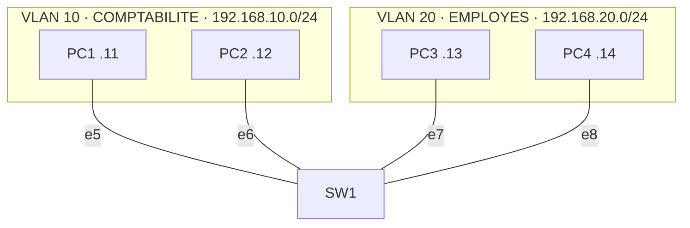

# 02 — Segmentation d'un réseau d'entreprise en VLAN

## Objectif
Isoler deux services (Comptabilité et Employés) sur le même switch physique grâce aux VLAN, et vérifier que les services ne peuvent pas communiquer sans routeur.

## Topologie

| Port SW1 | Mode | VLAN | Hôte |
|---|---|---|---|
| e5, e6 | access | 10 | PC1 192.168.10.11, PC2 192.168.10.12 |
| e7, e8 | access | 20 | PC3 192.168.20.13, PC4 192.168.20.14 |

## Tests réalisés
1. **Même VLAN** : PC1 → PC2 ✅ réponse.
2. **VLAN différents** : PC1 → PC3 ❌ « No gateway found » (pas de routeur, réseaux IP différents).
3. **Même plan IP mais VLAN différents** : PC3 placé temporairement en 192.168.10.13 → toujours injoignable depuis PC1. Preuve que l'isolation vient bien de la couche 2 (VLAN) et pas seulement de l'adressage.

## Intérêt sécurité
La segmentation limite la propagation d'un incident (broadcast, scan, malware) à un seul service : c'est la base du principe de **moindre privilège réseau**.

## Compétences
VLAN et ports access · domaines de diffusion · méthodologie de test par hypothèse

Configurations des postes : [`configs/`](configs/)
