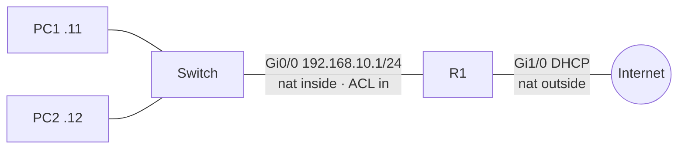

# 03 — Routeur pare-feu : NAT et filtrage par ACL

## Objectif
Donner accès à Internet à un réseau d'entreprise via NAT, puis transformer le routeur en **pare-feu simple** qui bloque les protocoles non chiffrés (HTTP et Telnet).

## Topologie



## Configuration clé

```cisco
ip nat inside source list 1 interface GigabitEthernet1/0 overload
access-list 1 permit 192.168.10.0 0.0.0.255
!
ip access-list extended PAREFEU-LAN
 remark Bloquer HTTP non chiffre
 deny   tcp 192.168.10.0 0.0.0.255 any eq www
 remark Bloquer Telnet
 deny   tcp 192.168.10.0 0.0.0.255 any eq telnet
 remark Autoriser tout le reste
 permit ip 192.168.10.0 0.0.0.255 any
!
interface GigabitEthernet0/0
 ip access-group PAREFEU-LAN in
```

## Étapes
1. Adressage LAN, WAN en DHCP, NAT overload (PAT).
2. Tests **avant** filtrage : ping Internet, résolution DNS, ports 80 et 443 joignables (`ping … -P 6 -p <port>` depuis VPCS), `show ip nat translations`.
3. Création et application de l'ACL étendue en entrée sur l'interface LAN.
4. Tests **après** filtrage : port 80 et port 23 bloqués, port 443 toujours autorisé ; vérification des compteurs avec `show access-lists` (hits sur les règles deny et permit).

## Pourquoi ces règles ?
HTTP et Telnet transmettent les données (y compris identifiants) en clair. Les bloquer en sortie force l'usage de HTTPS et SSH. L'ACL est placée **au plus près de la source** (en entrée du LAN), comme recommandé pour une ACL étendue.

## Pistes d'amélioration
- Journaliser les refus (`deny … log`) et les envoyer vers un syslog
- Passer à un pare-feu à états (Zone-Based Firewall IOS ou pfSense)
- Protéger l'accès VTY du routeur (`login local`, SSH uniquement)

## Compétences
NAT/PAT · ACL étendues · ordre de traitement des règles · tests de filtrage · vérification par compteurs

Configurations : [`configs/`](configs/)
