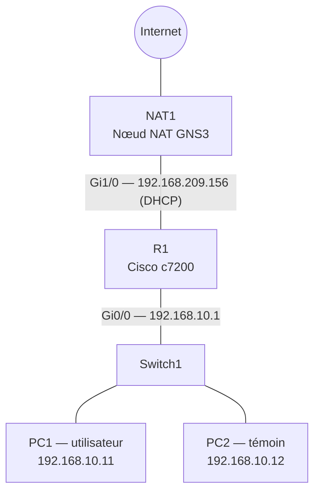

# Projet 4 — Diagnostic d'une panne réseau

**Cours :** Networking Essentials — Infrastructure informatique et réseau d'une petite entreprise
**Classe :** E1A — Geneva Institute of Technology
**Auteure :** Rrudhani Deaa 
**Date :** 14 octobre 2026

## Sommaire

[TOC]

---

## 1. Contexte

Un utilisateur (poste **PC1**) signale qu'il **n'accède plus au réseau**. Pour reproduire la situation, deux pannes ont été simulées dans le simulateur **GNS3**, puis diagnostiquées et résolues avec une **méthode de diagnostic couche par couche** basée sur le modèle OSI.

| Panne | Type | Couche OSI |
| --- | --- | --- |
| Panne 1 | Câble débranché | Couche 1 — Physique |
| Panne 2 | Mauvaise configuration IP | Couche 3 — Réseau |

## 2. Objectifs

- Utiliser une méthode de diagnostic réseau en couches (modèle OSI).
- Identifier la **cause racine** de chaque panne.
- Résoudre la panne et vérifier le retour à la normale.
- Documenter l'intervention avec des preuves de tests (configuration IP, ping, traceroute).

---

## 3. Méthodologie de diagnostic

### 3.1 Le modèle OSI

Le modèle OSI découpe le fonctionnement d'un réseau en **7 couches**. Chaque couche dépend de celles du dessous : si le câble est débranché (couche 1), rien ne peut fonctionner au-dessus.

On diagnostique donc **du bas vers le haut** (méthode « bottom-up ») : inutile de chercher un problème de DNS si le câble est débranché.

| Couche OSI | Ce qu'on vérifie | Outils utilisés |
| --- | --- | --- |
| 1 — Physique | Câble branché, interface allumée | État des liens dans GNS3, `show ip interface brief` sur R1 |
| 2 — Liaison | Port du switch, VLAN, adresses MAC | Configuration du switch |
| 3 — Réseau | Adresse IP, masque, passerelle, joignabilité | `show ip`, `ping`, `trace` |
| 7 — Application | Résolution des noms (DNS) | `ping google.com` |

### 3.2 Le poste témoin

Un deuxième poste, **PC2**, sert de **poste témoin** :
- si PC2 fonctionne et pas PC1 → le problème est **local** (PC1, son câble ou son port de switch) ;
- si PC2 ne fonctionne pas non plus → le problème est **central** (switch, routeur ou accès Internet).

### 3.3 Correspondance des outils

Les postes simulés (VPCS) utilisent des commandes équivalentes à celles de Windows :

| Windows | VPCS (GNS3) | À quoi ça sert |
| --- | --- | --- |
| `ipconfig /all` | `show ip` | Afficher la configuration IP : adresse, masque, passerelle, DNS, adresse MAC |
| `ping` | `ping` | Tester si une adresse répond |
| `tracert` | `trace` | Afficher le chemin (les routeurs traversés) jusqu'à une destination |
| `nslookup google.com` | `ping google.com` | Vérifier que le nom est bien traduit en adresse IP par le DNS |

---

## 4. Environnement de test

### 4.1 Topologie

| Équipement | Type dans GNS3 | Rôle | Connexions |
| --- | --- | --- | --- |
| PC1 | VPCS | Poste de l'utilisateur en panne | Switch1 |
| PC2 | VPCS | Poste témoin | Switch1 |
| Switch1 | Ethernet switch | Switch du bureau (configuration par défaut) | PC1, PC2, R1 |
| R1 | Routeur Cisco c7200 | Passerelle du bureau, NAT | Gi0/0 → Switch1, Gi1/0 → NAT1 |
| NAT1 | Nœud NAT | Fournit l'accès à Internet et une adresse par DHCP | R1 |




### 4.2 Plan d'adressage

| Équipement | Interface | Adresse IP | Masque | Passerelle | DNS |
| --- | --- | --- | --- | --- | --- |
| R1 | Gi0/0 (LAN) | 192.168.10.1 | 255.255.255.0 | — | — |
| R1 | Gi1/0 (Internet) | 192.168.209.156 (DHCP) | 255.255.255.0 | — | — |
| PC1 | e0 | 192.168.10.11 | 255.255.255.0 | 192.168.10.1 | 8.8.8.8 |
| PC2 | e0 | 192.168.10.12 | 255.255.255.0 | 192.168.10.1 | 8.8.8.8 |

### 4.3 Configuration du routeur R1

```bash
enable
configure terminal
hostname R1
interface GigabitEthernet0/0
 ip address 192.168.10.1 255.255.255.0
 ip nat inside
 no shutdown
 exit
interface GigabitEthernet1/0
 ip address dhcp
 ip nat outside
 no shutdown
 exit
access-list 1 permit 192.168.10.0 0.0.0.255
ip nat inside source list 1 interface GigabitEthernet1/0 overload
end
write memory
```


| Commande | À quoi elle sert |
| --- | --- |
| `enable` | Passe en mode privilégié (`R1#`) |
| `configure terminal` | Entre en mode de configuration |
| `hostname R1` | Donne le nom R1 au routeur |
| `interface GigabitEthernet0/0` | Sélectionne l'interface côté LAN (reliée au switch) |
| `ip address 192.168.10.1 255.255.255.0` | Adresse de la passerelle du bureau |
| `ip nat inside` | Indique que cette interface est du côté **interne** (le réseau du bureau) |
| `interface GigabitEthernet1/0` | Sélectionne l'interface côté Internet (reliée au nœud NAT) |
| `ip address dhcp` | Le routeur reçoit automatiquement son adresse côté Internet |
| `ip nat outside` | Indique que cette interface est du côté **externe** (Internet) |
| `no shutdown` | Active l'interface (éteinte par défaut sur un routeur Cisco) |
| `access-list 1 permit 192.168.10.0 0.0.0.255` | Liste les adresses autorisées à sortir sur Internet : tout le réseau 192.168.10.0/24 (`0.0.0.255` est le masque inversé, appelé *wildcard*) |
| `ip nat inside source list 1 interface Gi1/0 overload` | Active le **NAT** : les PC du bureau sortent sur Internet avec l'adresse unique de Gi1/0 (`overload` = plusieurs PC partagent la même adresse publique) |
| `end` | Quitte le mode configuration |
| `write memory` | Sauvegarde la configuration. Le routeur demande une confirmation pour écraser l'ancienne : on valide avec **Entrée** |

Pendant la configuration, R1 affiche des messages qui confirment le bon fonctionnement :
- `%LINK-3-UPDOWN ... changed state to up` : les interfaces Gi0/0 et Gi1/0 s'activent ;
- `%DHCP-6-ADDRESS_ASSIGN ... 192.168.209.156` : Gi1/0 a reçu son adresse par DHCP.


**Vérifications sur R1 :**

```bash
show ip interface brief
ping 8.8.8.8
```


| Vérification | Résultat |
| --- | --- |
| `show ip interface brief` | Gi0/0 : 192.168.10.1, **up / up** — Gi1/0 : 192.168.209.156 (méthode **DHCP**), **up / up**. Les autres interfaces, non utilisées, restent éteintes (*administratively down*) |
| `ping 8.8.8.8` | `!!!!!` **100 %** : R1 accède à Internet |


### 4.4 Configuration des postes

**PC1 :**

```bash
ip 192.168.10.11/24 192.168.10.1
ip dns 8.8.8.8
save
```


**PC2 :**

```bash
ip 192.168.10.12/24 192.168.10.1
ip dns 8.8.8.8
save
```


| Commande | À quoi elle sert |
| --- | --- |
| `ip 192.168.10.X/24 192.168.10.1` | Attribue l'adresse IP, le masque (/24 = 255.255.255.0) et la passerelle (R1) |
| `ip dns 8.8.8.8` | Définit le serveur DNS (celui de Google), qui traduit les noms comme `google.com` en adresses IP |
| `save` | Sauvegarde la configuration du poste (fichier `startup.vpc`) |

Après la commande `ip`, VPCS affiche « PC1 : … » sur tous les postes : c'est sa numérotation interne, pas une erreur.


---

## 5. État de référence (avant panne)

Avant de créer les pannes, l'état normal du réseau a été relevé sur les deux postes. C'est la **référence** qui permet de prouver ensuite que le réseau est bien rétabli.

Sur **PC1** et **PC2** :

```bash
show ip
ping 192.168.10.1
ping 8.8.8.8
ping google.com
trace 8.8.8.8
```


| Test | Ce qu'il vérifie | Couche | PC1 | PC2 |
| --- | --- | --- | --- | --- |
| `show ip` | Configuration IP correcte | 3 | ✅ | ✅ |
| `ping 192.168.10.1` | Accès à la passerelle (réseau local) | 3 | ✅ | ✅ |
| `ping 8.8.8.8` | Accès à Internet | 3 | ✅ | ✅ |
| `ping google.com` | Résolution DNS : `google.com` → 74.125.29.x | 7 | ✅ | ✅ |
| `trace 8.8.8.8` | Chemin vers Internet | 3 | ✅ | ✅ |

**Lecture des résultats de ping :**

| Élément | Signification |
| --- | --- |
| `84 bytes from 192.168.10.1` | Une réponse est arrivée de l'adresse pinguée |
| `icmp_seq=1` | Numéro du paquet |
| `ttl=255` (pour R1) | Valeur de départ d'un routeur Cisco : R1 est directement joignable |
| `ttl=127` (pour 8.8.8.8) | Le paquet a traversé plusieurs routeurs pour arriver |
| `time=16 ms` | Temps aller-retour |

**Lecture du `trace 8.8.8.8` :**

| Saut | Adresse | Signification |
| --- | --- | --- |
| 1 | 192.168.10.1 | **R1**, la passerelle du bureau |
| 2 | 192.168.209.2 | La passerelle du réseau NAT (sortie vers Internet) |
| 3 | `*` | Les équipements suivants ne répondent pas au traceroute (ils filtrent ce type de message). C'est normal : le `ping 8.8.8.8` prouve que la destination est bien joignable |


---

## 6. Intervention n°1 — Panne de câble (couche 1)

### 6.1 Fiche d'incident

| Élément | Détail |
| --- | --- |
| Poste concerné | PC1 (192.168.10.11) |
| Symptôme signalé | « Je n'accède plus au réseau ni à Internet » |
| Panne simulée | Câble PC1 — Switch1 **suspendu** dans GNS3 (clic droit sur le câble → **Suspend**), équivalent d'un câble débranché ou coupé |


### 6.2 Constat des symptômes

Sur **PC1** :

```bash
ping 192.168.10.1
ping 8.8.8.8
```


| Test | Résultat |
| --- | --- |
| `ping 192.168.10.1` | ❌ `host (192.168.10.1) not reachable` |
| `ping 8.8.8.8` | ❌ `host (192.168.10.1) not reachable` |

**Explication :** pour joindre une adresse, PC1 doit d'abord trouver l'adresse MAC de sa passerelle grâce à une **requête ARP**. Comme le câble est coupé, cette requête n'atteint personne : la passerelle 192.168.10.1 est « injoignable », et donc Internet aussi.


### 6.3 Diagnostic couche par couche

**Étape 1 — Comparaison avec le poste témoin**

Sur **PC2** :

```bash
ping 192.168.10.1
```

→ ✅ La passerelle répond. Le routeur et le switch fonctionnent : le problème est **local à PC1**.


**Étape 2 — Couche 1 (Physique)**

Observation du câble PC1 — Switch1 dans GNS3 : le lien est **suspendu** (symbole pause, voyants jaunes au lieu de verts).
❌ **Anomalie trouvée.**

**Étape 3 — Couche 3 (Réseau), pour confirmer**

Sur **PC1** :

```bash
show ip
```

→ Adresse 192.168.10.11/24, passerelle 192.168.10.1, DNS 8.8.8.8 : ✅ la configuration IP est correcte. Le problème ne vient donc pas de l'adressage.


### 6.4 Cause racine

**Câble entre PC1 et Switch1 débranché** (lien suspendu). PC1 n'a plus aucune liaison physique avec le réseau.

### 6.5 Résolution

Dans GNS3 : clic droit sur le câble PC1 — Switch1 → **Resume**. Le lien redevient actif, les voyants repassent au **vert**.


### 6.6 Vérification

Sur **PC1** :

```bash
ping 192.168.10.1
ping 8.8.8.8
ping google.com
```

| Test | Résultat |
| --- | --- |
| Passerelle | ✅ |
| Internet | ✅ |
| DNS (`google.com` → 74.125.29.100) | ✅ |

→ Résultats identiques à l'état de référence : **le réseau est rétabli.**


---

## 7. Intervention n°2 — Mauvaise configuration IP (couche 3)

### 7.1 Fiche d'incident

| Élément | Détail |
| --- | --- |
| Poste concerné | PC1 |
| Symptôme signalé | « Je n'accède plus au réseau ni à Internet » |
| Panne simulée | Erreur de saisie dans la configuration IP de PC1 |

Commande utilisée pour créer la panne, sur **PC1** :

```bash
ip 192.168.1.11/24 192.168.1.1
```


### 7.2 Constat des symptômes

Sur **PC1** :

```bash
ping 192.168.10.1
ping 8.8.8.8
ping google.com
```


| Test | Résultat |
| --- | --- |
| `ping 192.168.10.1` | ❌ `host (192.168.1.1) not reachable` |
| `ping 8.8.8.8` | ❌ `host (192.168.1.1) not reachable` |
| `ping google.com` | ❌ `host (192.168.1.1) not reachable` + `Cannot resolve google.com` |

**Indices importants :**
- Le message parle de **192.168.1.1**, une adresse qui **n'existe pas** dans le plan d'adressage : PC1 essaie de passer par une mauvaise passerelle.
- `Cannot resolve google.com` : le serveur DNS est injoignable, le nom ne peut donc pas être traduit en adresse IP. Ce n'est pas le DNS qui est en panne, c'est PC1 qui ne peut pas l'atteindre.


### 7.3 Diagnostic couche par couche

**Étape 1 — Comparaison avec le poste témoin**

Sur **PC2** :

```bash
ping 192.168.10.1
```

→  La passerelle répond : le problème est **local à PC1**.


**Étape 2 — Couche 1 (Physique)**

Le câble PC1 — Switch1 est actif dans GNS3 (voyants **verts**).
 Pas de problème physique.


**Étape 3 — Couche 3 (Réseau)**

Sur **PC1** :

```bash
show ip
```


Comparaison avec le plan d'adressage :

| Paramètre | Attendu | Constaté | |
| --- | --- | --- | --- |
| Adresse IP | 192.168.10.11/24 | **192.168.1.11/24** | ❌ |
| Passerelle | 192.168.10.1 | **192.168.1.1** | ❌ |
| DNS | 8.8.8.8 | 8.8.8.8 | ✅ |

**Anomalie trouvée :** PC1 est configuré dans le réseau **192.168.1.0/24**, alors que le bureau est en **192.168.10.0/24**. Il ne peut joindre ni ses voisins, ni la vraie passerelle, ni donc Internet et le serveur DNS.


### 7.4 Cause racine

**Mauvaise configuration IP sur PC1** : adresse et passerelle saisies dans le réseau 192.168.1.0/24 au lieu de 192.168.10.0/24 (erreur de saisie : « 1 » au lieu de « 10 »).

### 7.5 Résolution

Sur **PC1** :

```bash
ip 192.168.10.11/24 192.168.10.1
save
show ip
```

| Commande | À quoi elle sert |
| --- | --- |
| `ip 192.168.10.11/24 192.168.10.1` | Remet la bonne adresse, le bon masque et la bonne passerelle |
| `save` | Sauvegarde la correction |
| `show ip` | Vérifie que la configuration correspond au plan d'adressage |

→ Adresse 192.168.10.11/24, passerelle 192.168.10.1, DNS 8.8.8.8 : conforme.


### 7.6 Vérification

Sur **PC1** :

```bash
ping 192.168.10.1
ping 8.8.8.8
ping google.com
trace 8.8.8.8
```


| Test | Résultat |
| --- | --- |
| Passerelle | ✅ |
| Internet | ✅ |
| DNS (`google.com` → 74.125.29.100) | ✅ |
| Chemin : R1 (192.168.10.1) → 192.168.209.2 | ✅ |

→ Résultats identiques à l'état de référence : **le réseau est rétabli.**


---

## 8. Synthèse des interventions

| | Intervention n°1 | Intervention n°2 |
| --- | --- | --- |
| **Symptôme** | PC1 n'accède plus à rien | PC1 n'accède plus à rien |
| **Message d'erreur** | `host (192.168.10.1) not reachable` | `host (192.168.1.1) not reachable` |
| **Poste témoin PC2** | ✅ Fonctionne | ✅ Fonctionne |
| **Couche 1** | ❌ Câble suspendu | ✅ Câble actif |
| **Couche 3** | ✅ Configuration correcte | ❌ Mauvaise adresse et passerelle |
| **Couche en cause** | 1 — Physique | 3 — Réseau |
| **Cause racine** | Câble PC1 — Switch1 débranché | Erreur de saisie de la configuration IP |
| **Résolution** | Câble rebranché (*Resume*) | Configuration IP corrigée |
| **Vérification** | Pings OK | Pings + trace OK |

**À retenir :** les deux pannes donnent le **même symptôme** pour l'utilisateur (« plus de réseau »). C'est la méthode couche par couche, et la comparaison avec un poste témoin, qui ont permis de trouver deux causes très différentes. Les **messages d'erreur** sont aussi des indices précieux : dans la panne 2, l'adresse 192.168.1.1 désignait directement le problème.

---

## 9. Recommandations

- **Pannes de câble :** étiqueter les câbles et les ports du switch, et utiliser des câbles de qualité. Dans un vrai bureau, vérifier en premier les **voyants** de la carte réseau et du port du switch.
- **Pannes de configuration IP :** tenir à jour un **plan d'adressage** et le consulter à chaque configuration. Pour éviter les erreurs de saisie, utiliser un **serveur DHCP**, qui attribue automatiquement les adresses.
- **En général :** relever l'**état de référence** du réseau quand tout fonctionne, pour pouvoir comparer rapidement en cas de panne, et toujours disposer d'un **poste témoin**.

---

## 10. Annexe — Commandes exécutées par équipement

### NAT1 — Nœud NAT

Aucune commande : le nœud NAT fonctionne automatiquement. Il donne une adresse à R1 par DHCP et lui fournit l'accès à Internet.

### Switch1 — Ethernet switch

Aucune commande : configuration par défaut (tous les ports en VLAN 1, type access).

| Action dans GNS3 | Rôle |
| --- | --- |
| Clic droit sur le câble PC1 — Switch1 → **Suspend** | Création de la panne 1 (câble débranché) |
| Clic droit sur le câble PC1 — Switch1 → **Resume** | Résolution de la panne 1 (câble rebranché) |

### R1 — Routeur Cisco c7200

```bash
enable
configure terminal
hostname R1
interface GigabitEthernet0/0
 ip address 192.168.10.1 255.255.255.0
 ip nat inside
 no shutdown
 exit
interface GigabitEthernet1/0
 ip address dhcp
 ip nat outside
 no shutdown
 exit
access-list 1 permit 192.168.10.0 0.0.0.255
ip nat inside source list 1 interface GigabitEthernet1/0 overload
end
write memory
show ip interface brief
ping 8.8.8.8
```

### PC1 — Poste de l'utilisateur

**Configuration :**

```bash
ip 192.168.10.11/24 192.168.10.1
ip dns 8.8.8.8
save
```

**État de référence :**

```bash
show ip
ping 192.168.10.1
ping 8.8.8.8
ping google.com
trace 8.8.8.8
```

**Panne 1 — symptômes, diagnostic, vérification :**

```bash
ping 192.168.10.1
ping 8.8.8.8
show ip
ping 192.168.10.1
ping 8.8.8.8
ping google.com
```

**Panne 2 — création, symptômes, diagnostic, résolution, vérification :**

```bash
ip 192.168.1.11/24 192.168.1.1
ping 192.168.10.1
ping 8.8.8.8
ping google.com
show ip
ip 192.168.10.11/24 192.168.10.1
save
show ip
ping 192.168.10.1
ping 8.8.8.8
ping google.com
trace 8.8.8.8
```

### PC2 — Poste témoin

**Configuration :**

```bash
ip 192.168.10.12/24 192.168.10.1
ip dns 8.8.8.8
save
```

**État de référence :**

```bash
show ip
ping 192.168.10.1
ping 8.8.8.8
ping google.com
trace 8.8.8.8
```

**Comparaison pendant la panne 1 et la panne 2 :**

```bash
ping 192.168.10.1
```

---

## 11. Liste des captures

| N° | Fichier | Contenu |
| --- | --- | --- |
| 01 | `01_topologie_annotee.png` | Topologie GNS3 annotée avec les commandes |
| 02 | `02_topologie_liens_actifs.png` | Topologie, tous les liens actifs (réutilisée en 14 et 19) |
| 03 | `03_r1_config.png` | Configuration de R1 |
| 04 | `04_r1_show_ip_int_brief.png` | Interfaces de R1 |
| 05 | `05_r1_ping_internet.png` | R1 accède à Internet |
| 06 | `06_pc1_config.png` | Configuration de PC1 |
| 07 | `07_pc2_config.png` | Configuration de PC2 |
| 08 | `08_pc1_etat_normal.png` | État de référence PC1 |
| 09 | `09_pc2_etat_normal.png` | État de référence PC2 |
| 10 | `10_panne1_cable_suspendu.png` | Panne 1 : câble suspendu |
| 11 | `11_panne1_symptomes_pc1.png` | Panne 1 : pings en échec sur PC1 |
| 12 | `12_panne1_pc1_ko_pc2_ok.png` | Panne 1 : PC1 KO, PC2 OK |
| 13 | `13_panne1_show_ip_pc1.png` | Panne 1 : configuration IP de PC1 correcte |
| 14 | `02_topologie_liens_actifs.png` | Panne 1 : câble rétabli |
| 15 | `15_panne1_verification.png` | Panne 1 : pings OK |
| 16 | `16_panne2_creation.png` | Panne 2 : création de la panne |
| 17 | `17_panne2_symptomes_pc1.png` | Panne 2 : pings en échec sur PC1 |
| 18 | `18_panne2_pc2_ok.png` | Panne 2 : PC2 OK |
| 19 | `02_topologie_liens_actifs.png` | Panne 2 : câble actif |
| 20 | `20_panne2_show_ip_pc1.png` | Panne 2 : mauvaise configuration IP |
| 21 | `21_panne2_correction.png` | Panne 2 : correction de l'IP |
| 22 | `22_panne2_verification.png` | Panne 2 : pings + trace OK |