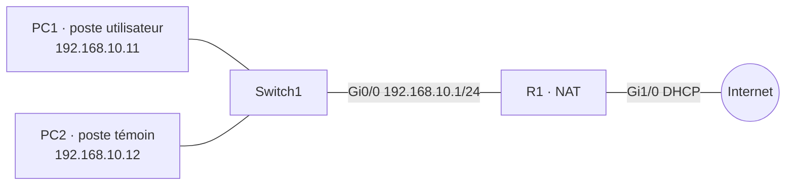

# 04 — Diagnostic méthodique d'une panne réseau

## Objectif
Simuler une panne sur un poste utilisateur, la diagnostiquer avec une méthode structurée (modèle OSI, approche **bottom-up**) et rédiger un rapport d'intervention.

## Topologie

## Méthode
1. **Recueillir le symptôme** : « PC1 n'accède plus au réseau ».
2. **Comparer avec un poste témoin** (PC2) pour savoir si la panne est locale ou générale.
3. **Remonter les couches OSI** :
   - Couche 1 : état du lien / câble
   - Couche 2 : présence dans la table ARP / MAC
   - Couche 3 : adresse IP, masque, passerelle (`show ip` sur VPCS), ping passerelle
   - Couches supérieures : DNS, accès Internet
4. **Corriger, puis re-tester** toute la chaîne.
5. **Documenter** dans un rapport d'intervention (symptôme, diagnostic, cause, correction, vérification, prévention).

## Pannes étudiées
| Couche | Panne simulée | Indice décisif |
|---|---|---|
| 1 — Physique | Lien PC1 ↔ switch coupé | Aucun ARP, témoin OK |
| 3 — Réseau | Adresse erronée 192.168.1.11 sur PC1 | Réseau différent de la passerelle |

## Compétences
Démarche de dépannage structurée · commandes de vérification · rédaction d'un rapport d'intervention professionnel — compétences directement réutilisables en support N1/N2 et en réponse à incident.

Configurations : [`configs/`](configs/)
